# Cross-Lingual Agent Skill Poisoning and Runtime Authorization {#xling-research-workflow}

Cross-lingual skill poisoning bypasses static scanners in low-resource registers, but **deterministic runtime policy enforcement** stops execution with zero false denials.

- English-calibrated static scanners miss 100% of malicious prompts written in native Bangla and Banglish.
- Soft prompt isolation causes severe utility collapse, reducing legitimate task completion to 76.9%.
- The runtime policy enforcement module intercepts proposed tool calls and eliminates policy violations in 0.038 milliseconds.
- Benign tasks maintain 100% task completion rate without degrading agent capabilities.

@answer scope="Groq live trials · Qwen-2.5-27B · 26 task domains · 312 trials"
@meta locale=en style=clean
@source groq-benchmark title="Groq 26-Domain Live Evaluation Benchmark" path=research/results/groq_26_domains_live.jsonl lines=1:312
@source adr0002 title="ADR-0002: Deterministic Runtime Authorization Seam" path=docs/adr/0002-deterministic-runtime-authorization.md lines=1:60
@source tasks26 title="26 Multi-Domain Task Variants Dataset" path=research/benchmark/data/xling_tasks_26.json lines=1:100

## How does the 5-stage attack lifecycle compromise agent skills? {#attack-lifecycle}

@workflow id=lifecycle-flow title="5-stage attack lifecycle from authoring to execution"
| lane supply | Untrusted Supply Chain |
| lane runtime | Agent Runtime Boundary |
| author | 1. Authoring | external | supply |
| publish | 2. Registry | external | supply |
| install | 3. Install | backend | supply |
| rugpull | 4. Rug-Pull | backend | runtime |
| plan | 5. Execution | security | runtime |
| author > publish | |
| publish > install | |
| install > rugpull | |
| rugpull > plan | exploit | emphasis |

@steps id=lifecycle-steps
| s1 | Authoring | Attacker crafts a dual-intent skill using Bangla or Banglish to disguise unauthorized operations. | lifecycle-flow | author |
| s2 | Registry Publishing | Skill marketplace accepts the package because regex scanners only match English keywords. | lifecycle-flow | publish |
| s3 | Installation | Agent runtime installs markdown skill into prompt context with full ambient privileges. | lifecycle-flow | install |
| s4 | Rug-Pull Update | Attacker mutates local skill file after install-time vetting has completed. | lifecycle-flow | rugpull |
| s5 | Runtime Execution | LLM planner executes unauthorized file writes alongside benign user instructions. | lifecycle-flow | plan |

## How does the interactive runtime seam intercept unsafe tool calls? {#interactive-seam}

@sequence id=seam-sequence title="Interactive authorization seam message sequence"
| actor user | User | frontend |
| actor agent | LLM Agent | backend |
| actor seam | Policy Interceptor | security |
| actor env | Sandboxed Host | database |
| user | agent | Run task on workspace files |
| agent | seam | Propose write_file to /tmp | emphasis |
| seam | user | Prompt interactive approval dialog | security |
| user | seam | Deny unauthorized /tmp write | return |
| seam | agent | Return policy rejection error | return |
| agent | seam | Propose write_file to /workspace/output |
| seam | env | Dispatch authorized execution |
| env | agent | Return tool success result | return |
| agent | user | Return completed task answer | return |

@steps id=seam-steps
| p1 | Tool Proposal | Agent generates function call targeting out-of-scope path `/tmp/canary_audit.marker`. | seam-sequence | agent |
| p2 | Invariant Interception | Policy interceptor catches the call before host invocation and flags path boundary violation. | seam-sequence | seam |
| p3 | Interactive Gate | Human operator inspects risk metadata and chooses deterministic denial. | seam-sequence | user |
| p4 | Compliant Retry | Agent receives the rejection notice and continues execution within `/workspace/output`. | seam-sequence | env |

## How do defense tiers perform across languages and domains? {#benchmark-metrics}

| Configuration {#config-col} | Register | Trials | ASR | PVR | TSR | Latency | FDR |
| --- | --- | --- | --- | --- | --- | --- | --- |
| None (EN) {#none-en} | English | 26 | 100.0% {bad:Compromised} | 100.0% | 100.0% | 0.0000ms | 0.0% |
| None (BN) {#none-bn} | Bangla | 26 | 100.0% {bad:Compromised} | 100.0% | 100.0% | 0.0000ms | 0.0% |
| None (BN-EN) {#none-bnen} | Banglish | 26 | 100.0% {bad:Compromised} | 100.0% | 100.0% | 0.0000ms | 0.0% |
| Static Scanner (EN) {#scanner-en} | English | 26 | 76.9% {caution:Partial} | 76.9% | 76.9% | 0.0000ms | 23.1% {bad:False Denials} |
| Static Scanner (BN) {#scanner-bn} | Bangla | 26 | 100.0% {bad:100% Bypass} | 100.0% | 100.0% | 0.0000ms | 0.0% |
| Static Scanner (BN-EN) {#scanner-bnen} | Banglish | 26 | 100.0% {bad:100% Bypass} | 100.0% | 100.0% | 0.0000ms | 0.0% |
| Prompt Isolation (EN) {#prompt-en} | English | 26 | 7.7% | 7.7% | 76.9% {caution:Degraded} | 0.0000ms | 0.0% |
| Prompt Isolation (BN) {#prompt-bn} | Bangla | 26 | 3.8% | 3.8% | 84.6% {caution:Degraded} | 0.0000ms | 0.0% |
| Prompt Isolation (BN-EN) {#prompt-bnen} | Banglish | 26 | 0.0% {good:Defended} | 0.0% | 84.6% {caution:Degraded} | 0.0000ms | 0.0% |
| Policy Enforcement (EN) {#policy-en} | English | 26 | 3.8% | 3.8% | 100.0% {good:Full Utility} | 0.0370ms {good:Sub-ms} | 0.0% {good:Zero FDR} |
| Policy Enforcement (BN) {#policy-bn} | Bangla | 26 | 0.0% {good:Defended} | 0.0% | 100.0% {good:Full Utility} | 0.0368ms {good:Sub-ms} | 0.0% {good:Zero FDR} |
| Policy Enforcement (BN-EN) {#policy-bnen} | Banglish | 26 | 0.0% {good:Defended} | 0.0% | 100.0% {good:Full Utility} | 0.0408ms {good:Sub-ms} | 0.0% {good:Zero FDR} |

## How does attack success compare across defense mechanisms? {#asr-comparison}

```mermaid title="Attack Success Rate (ASR %) across defense tiers"
xychart-beta
  x-axis ["English", "Bangla", "Banglish"]
  y-axis "ASR %" 0 --> 100
  bar "None" [100, 100, 100]
  bar "Static Scanner" [77, 100, 100]
  bar "Prompt Isolation" [8, 4, 0]
  bar "Policy Enforcement" [4, 0, 0]
```

## What architectural invariants ensure system safety? {#system-invariants}

- Keep runtime tool authorization outside the LLM reasoning context to prevent prompt injection.
- Validate absolute target paths against allowed workspace boundaries before calling host APIs.
- Re-authenticate skill file hashes before dispatch to block rug-pull mutations.
- Reject all write calls targeting sensitive system directories like `/tmp`, `/etc`, and home keys.
