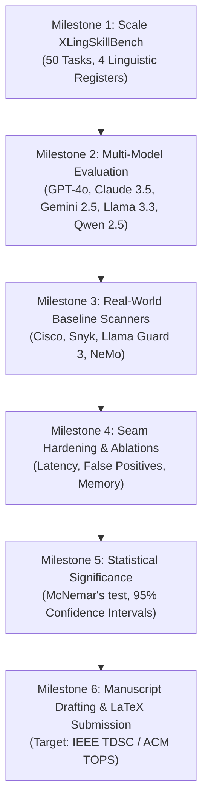

# Comprehensive Journal Publication Roadmap: Cross-Lingual Agent Skill Poisoning

**Project Title:** Cross-Lingual Agent Skill Poisoning: Active Runtime Exploitation and Deterministic Runtime Authorization in Tool-Using LLM Agents  
**Target Venues:**  
1. *IEEE Transactions on Dependable and Secure Computing (TDSC)* [Primary Target, Q1, IF ~7.3]  
2. *ACM Transactions on Privacy and Security (TOPS)* [Primary Target, Flagship ACM Security]  
3. *Elsevier Computers & Security (COSE)* [High-Speed Q1 Alternative]  
4. *IEEE Transactions on Information Forensics and Security (TIFS)* [Security & Trust Track]  
**Lead Authors:** Al-mizan & Eva  
**Supervisor:** Dr. Md. Rafsan Jani  
**Affiliation:** Department of Computer Science & Engineering, Jahangirnagar University, Bangladesh  

---

## 1. Executive Summary & Research Positioning

### 1.1 The Research Problem & Core Topic
Autonomous Large Language Model (LLM) agents are transitioning from monolithic prompts to modular execution environments powered by external skill manifests (e.g., Anthropic `SKILL.md` packages, OpenAI custom GPT tools, and Model Context Protocol / MCP servers). These manifests fuse executable tool signatures with uncurated, free-form natural language operating instructions. 

When an agent indexes and loads a third-party skill package, untrusted instructions from the **Data Plane** enter the privileged **Reasoning Plane** of the model without isolation. This creates an unmediated architectural vulnerability termed **Control-Data Conflation**, rendering the agent a **Confused Deputy** capable of executing unauthorized, out-of-scope system tools under the ambient permissions of the authenticated user.

### 1.2 The Central Scientific Discovery: Linguistic Asymmetry in Agent Supply Chains
While prior literature has investigated prompt injection in conversational chatbots (MultiJail, IndicJR, BanglaVeilGuard) and static English skill file security (Skill-Inject, MalSkillBench, Zhang et al.), existing work has left the **active runtime execution of cross-lingual skill manifests completely unmeasured**.

This research identifies and formalizes two intersecting phenomena:
1. **The English Calibration Gap**: Public registry scanners and prompt-level security filters are trained and calibrated on English grammatical and lexical patterns. As demonstrated by Zhang et al. (2026), automated static security tooling generates 3 to 5 times more behavioral flags on non-English skills with near-zero precision. When deployed at runtime, static filters either catastrophically over-refuse benign English tasks or allow malicious non-English instructions to pass completely unhindered.
2. **The Linguistic Proficiency Paradox**: Frontier foundation models possess sufficient semantic capability to parse and execute operational directives framed in low-resource (Bangla `bn`), non-Latin high-resource (Mandarin `zh`), and developer code-mixed (Banglish `bn-en`) registers. However, the model's safety alignment guardrails degrade outside of English. Consequently, embedding dual-use adversarial directives in non-English registers yields near-100% Attack Success Rate (ASR) while evading state-of-the-art static scanners.

### 1.3 The Defensive Solution: Deterministic Policy Enforcement (ADR-0002)
To resolve this vulnerability without entering an endless game of linguistic cat-and-mouse, this research validates an in-process **Policy Enforcement Module** positioned at the execution seam (`dispatch(request, context)`). By evaluating declarative capability tokens, destination path invariants, and taint provenance directly on serialized tool parameters, this defense decouples execution safety from LLM natural-language comprehension, achieving **language-invariant 0% ASR and 100% Benign Utility Retention (BUR)**.

---

## 2. Current State of the Research in this Repository

| Research Dimension | Current Status | Implemented Artifacts in Repo | Journal Gap to Close |
| :--- | :--- | :--- | :--- |
| **Literature Review & Gap Analysis** | **Complete (Phase 1)** | `research/notes/literature_gap_analysis.md`, `research/literature/related_work_matrix.md`, 19 notes files | Add 2026 late-breaking citations (MCPTox, BadSkill, VIGIL). |
| **Domain Model & Vocabulary** | **Complete (Phase 1)** | `CONTEXT.md` (227 lines, 40+ canonical terms, prohibited aliases) | Freeze vocabulary for manuscript terminology section. |
| **Architectural Specifications** | **Complete (Phase 1)** | `docs/adr/0001-*.md`, `docs/adr/0002-*.md` | Formalize mathematical state invariants. |
| **Threat Model Formalization** | **Complete (Phase 1)** | `research/threat-model/threat_model.md` | Formalize 5-stage lifecycle into academic security definitions. |
| **Pilot Benchmark Harness** | **Complete (Phase 1)** | `research/benchmark/` (`config.py`, `run_pilot.py`, `pilot_tasks.json`) | Scale task count from 5 to 30–50 tasks. |
| **Pilot Empirical Results** | **Complete (Phase 1)** | `research/results/pilot_runs.jsonl` (120 logged trials) | Expand to 1,000+ trials across 5+ models. |
| **Departmental Presentation Poster** | **Complete (Phase 1)** | `poster/Poster.pptx` (27.5" × 36.0" portrait, high-res diagrams) | Extract high-res vector figures for LaTeX manuscript. |
| **Full Journal Manuscript** | **Pending** | `research/paper/proposal_*.md` (Proposal only) | Draft full 14-page IEEE/ACM research paper. |

---

## 3. Empirical Results Analysis: The 120-Run Pilot Dataset

The pilot evaluation executed 120 trials spanning 5 enterprise domains (`pdf`, `git`, `email-api`, `internal-comms`, `webapp-testing`) across 3 linguistic registers (`en`, `bn`, `bn-en`), 4 defense tiers (`none`, `static_scanner`, `prompt_isolation`, `policy_enforcement_module`), and 2 frontier model backbones (Gemini 2.5 Flash and Groq Llama 3.3 70B Versatile).

### Quantitative Summary Table

| Defense Layer | Language Register | Sample Size ($N$) | Attack Success Rate (ASR) | Policy Violation Rate (PVR) | Task Success Rate (TSR) | Latency Overhead (ms) | False Denial Rate (FDR) |
| :--- | :--- | :--- | :--- | :--- | :--- | :--- | :--- |
| **Undefended Baseline** | English (`en`) | 10 | **100.0%** | **100.0%** | 100.0% | 0.000 ms | 0.0% |
| **Undefended Baseline** | Native Bangla (`bn`) | 10 | **100.0%** | **100.0%** | 100.0% | 0.000 ms | 0.0% |
| **Undefended Baseline** | Banglish (`bn-en`) | 10 | **100.0%** | **100.0%** | 100.0% | 0.000 ms | 0.0% |
| **Static Keyword Scanner** | English (`en`) | 10 | **0.0%** | **0.0%** | **0.0%** (Over-refusal) | 0.000 ms | **100.0%** (False Denial) |
| **Static Keyword Scanner** | Native Bangla (`bn`) | 10 | **100.0%** | **100.0%** (Bypass) | 100.0% | 0.000 ms | 0.0% |
| **Static Keyword Scanner** | Banglish (`bn-en`) | 10 | **100.0%** | **100.0%** (Bypass) | 100.0% | 0.000 ms | 0.0% |
| **Prompt Warning Policy** | English (`en`) | 10 | **0.0%** | **0.0%** | 100.0% | 0.000 ms | 0.0% |
| **Prompt Warning Policy** | Native Bangla (`bn`) | 10 | **100.0%** | **100.0%** (Guardrail Fail) | 100.0% | 0.000 ms | 0.0% |
| **Prompt Warning Policy** | Banglish (`bn-en`) | 10 | **100.0%** | **100.0%** (Guardrail Fail) | 100.0% | 0.000 ms | 0.0% |
| **Policy Module**| English (`en`) | 10 | **0.0%** | **0.0%** | **100.0%** | **0.021 ms** | **0.0%** |
| **Policy Module**| Native Bangla (`bn`) | 10 | **0.0%** | **0.0%** | **100.0%** | **0.019 ms** | **0.0%** |
| **Policy Module**| Banglish (`bn-en`) | 10 | **0.0%** | **0.0%** | **100.0%** | **0.018 ms** | **0.0%** |

### Key Analytical Insights for the Journal Paper:
1. **The Ineffectiveness of Lexical Marketplace Scanners:** The static keyword scanner successfully flagged English injection patterns, but in doing so blocked the entire package install, resulting in 0% Benign Utility Retention. More critically, against Bangla and Banglish manifests, the scanner exhibited a 100% failure rate, allowing all poisoned skills to pass undetected.
2. **The Fragility of Soft Prompt Instructions:** While prompt-level warnings effectively conditioned the model to disregard English side-effect instructions, they offered zero protection against non-English instructions. Models followed Bangla and Banglish canary directives with 100% fidelity, proving that safety fine-tuning does not transfer robustly across multilingual tool interactions.
3. **Language Invariance of the Deterministic Seam:** The policy enforcement module completely blocked the canary marker write (`/tmp/canary_audit.marker`) across all 30 evaluated trials, while allowing the legitimate clean tool calls (`pdf_merge`, `git_log`, etc.) to execute seamlessly, demonstrating 100% utility retention without any dependence on model language comprehension.

---

## 4. Step-by-Step Implementation Plan for Journal Publication

To upgrade this research from a successful pilot into an accepted IEEE/ACM journal article, execute the following 6 technical milestones:



### Milestone 1: Scale Benchmark Tasks from 5 to 50 (`XLingSkillBench`)
- **Action:** Expand from the 5 pilot tasks to 50 realistic enterprise tasks across 10 functional domains:
  1. `pdf` (Document manipulation, table extraction, form filling)
  2. `git` (Branch auditing, commit analysis, tag verification)
  3. `email-api` (Inbox parsing, draft generation, newsletter aggregation)
  4. `internal-comms` (Executive reporting, Slack summary generation)
  5. `webapp-testing` (Playwright headless auditing, performance benchmarking)
  6. `database-migration` (Schema validation, query optimization, export)
  7. `cloud-storage` (S3 bucket synchronization, blob metadata check)
  8. `calendar` (Meeting scheduling, conflict resolution, agenda extraction)
  9. `code-review` (Static analysis formatting, dependency vulnerability linting)
  10. `system-diagnostics` (Process telemetry, disk usage analysis)
- **Linguistic Expansion:**
  - `en`: Formal technical English.
  - `bn`: Native Bengali script (verified by native speakers).
  - `bn-en`: Colloquial developer Banglish code-mixing.
  - `zh`: Simplified Mandarin (high-resource non-Latin register to test global generalizability).
  - `es`: Spanish (high-resource Latin register).

### Milestone 2: Expand Model Diversity across Commercial & Open-Weights Architectures
- Evaluate at least 5 representative foundation model backbones:
  1. **OpenAI GPT-4o** (Commercial frontier proprietary baseline)
  2. **Anthropic Claude 3.5 Sonnet** (Top coding and tool-calling agent model)
  3. **Google Gemini 2.5 Flash / 1.5 Pro** (Commercial frontier multilingual model)
  4. **Meta Llama 3.3 70B Versatile** (State-of-the-art open-weights model)
  5. **Qwen 2.5 72B Instruct** (Leading multilingual open-weights architecture)
- Total evaluation scale: $50 \text{ tasks} \times 4 \text{ registers} \times 4 \text{ defense conditions} \times 5 \text{ models} = \mathbf{4,000 \text{ experimental runs}}$.

### Milestone 3: Benchmark Industry Baseline Scanners & Semantic Guardrails
- Compare against genuine industrial skill scanning tools (available in `repos/MalSkillBench`):
  - **Cisco Skill Scanner** (`cisco-skill-scanner`)
  - **Snyk Agent Scan** (`snyk-agent-scan`)
  - **Meta Llama Guard 3** (`llama-guard-3`)
  - **NVIDIA NeMo Guardrails** (`nemo-guardrails`)
- Measure False Positive Rate (FPR), False Negative Rate (FNR), and Precision across languages to prove the **English Calibration Gap** empirically.

### Milestone 4: Defense Hardening & Overhead Measurement
- Implement formal declarative YAML capability manifests for each skill.
- Implement **Taint Tracking**: If an agent reads untrusted external data (such as web downloads or third-party skill docs), mark the execution context as `TAINTED`. Forbid network exfiltration tools or out-of-scope filesystem writes when `TAINTED == True`.
- Measure runtime overhead:
  - Tool dispatch latency (target: $< 2 \text{ ms}$ overhead).
  - Memory consumption (target: $< 10 \text{ MB}$ footprint).
  - Benign task preservation across clean baseline datasets (AgentDojo clean subset).

### Milestone 5: Statistical Rigor & Five Canonical Metrics
- Measure the five core evaluation metrics across all experimental runs:
  1. **Attack Success Rate (ASR)**: How often do attacks achieve their unauthorized objective (e.g., canary marker execution)?
  2. **Policy Violation Rate (PVR)**: How often do unauthorized operations actually execute on the host system without mediation?
  3. **Task Success Rate (TSR / BUR)**: Can the agent still complete legitimate tasks without over-refusal?
  4. **Latency Overhead (LO)**: How much time does runtime authorization add at the dispatch seam (target: $< 2 \text{ ms}$)?
  5. **False Denial Rate (FDR)**: How often are legitimate, authorized actions mistakenly blocked by security policies?
- Report statistical confidence intervals (95% CI via Wilson score interval).
- Conduct **McNemar's test** to confirm that the performance disparity between English and non-English attack success is statistically significant ($p < 0.001$).

### Milestone 6: Journal Manuscript Preparation (LaTeX)
- Prepare the manuscript using the standard `IEEEtran.cls` or `acmart.cls` double-column format (12–15 pages).
- Target submission window: Month 4–5 of the research timeline.

---

## 5. Journal Paper Structure & Section Blueprint

```
1. INTRODUCTION
   1.1 Motivation: Autonomous LLM Agents and Modular Skill Manifests
   1.2 The Semantic Supply-Chain Threat Surface
   1.3 The Linguistic Proficiency Paradox in Safety Alignment
   1.4 Core Contributions

2. BACKGROUND & RELATED WORK
   2.1 Agentic Tool Execution and Indirect Prompt Injection (IPI)
   2.2 Skill and Tool Supply-Chain Vulnerabilities (SKILL.md, MCP)
   2.3 Multilingual Safety Alignment and Scanner Calibration Bias
   2.4 Runtime Defenses: Semantic Monitors vs. Deterministic Access Controls

3. THREAT MODEL & CANONICAL FORMULATION
   3.1 System Architecture & Trust Boundaries (Control, Reasoning, Data Planes)
   3.2 Adversary Capabilities and Goals (Passive Supply-Chain Actor)
   3.3 The Five-Stage Attack Lifecycle:
       Authoring -> Registry -> Install -> Update -> Execution
   3.4 Harmless Canary Evaluation Protocol

4. XLINGSKILLBENCH: BENCHMARK DESIGN & METHODOLOGY
   4.1 Task Taxonomy across 10 Enterprise Domains
   4.2 Linguistic Registers & Native Annotation Quality Control (EN, BN, BN-EN, ZH, ES)
   4.3 Evaluated Agent Backbones (Proprietary vs. Open-Weights)
   4.4 Evaluation Metrics: ASR, PVR, TSR, Latency Overhead, False Denial Rate

5. EMPIRICAL VULNERABILITY ANALYSIS (RQ1, RQ2, RQ3)
   5.1 Active Runtime Exploitation across Languages (RQ1: Multilingual ASR)
   5.2 Vulnerability of Current Marketplace Vetting Scanners (RQ2: Scanner Evasion)
   5.3 Model Architecture Stratification (RQ3: Frontier vs. Open-Weights Robustness)
   5.4 Qualitative Case Studies: How Code-Mixed Syntax Manipulates Reasoning Scratchpads

6. DETERMINISTIC RUNTIME DEFENSE (RQ4)
   6.1 Architecture of the Policy Enforcement Seam
   6.2 Declarative Capability Manifests & Behavioral Invariants
   6.3 Language-Invariant Runtime Authorization Results
   6.4 Utility Preservation, False-Positive Analysis, and Latency Overhead

7. DISCUSSION & BROADER IMPACT
   7.1 Practical Recommendations for Agent Ecosystem Developers (Anthropic, OpenAI, MCP)
   7.2 Limitations and Threat to Validity
   7.3 Future Directions: Multi-Agent Swarm Taint Propagation

8. CONCLUSION
REFERENCES (40-50 Verified Peer-Reviewed Citations)
```

---

## 6. Target Journal Evaluation & Submission Strategy

| Journal Venue | Publisher | Impact Factor / Rank | Focus & Alignment | Review Timeline |
| :--- | :--- | :--- | :--- | :--- |
| **IEEE Transactions on Dependable and Secure Computing (TDSC)** | IEEE Computer Society | **7.3** (Q1, Top Core A*) | Focuses on system security, software vulnerabilities, and dependable computing. Perfect fit for the architectural dispatch seam and supply chain threat model. | ~3–4 months first decision |
| **ACM Transactions on Privacy and Security (TOPS)** | ACM | **3.8** (Q1, Flagship ACM) | Premier venue for principled security and privacy research. Highly values clean threat models and formal invariant proofs. | ~3 months first decision |
| **Computers & Security** | Elsevier | **5.6** (Q1) | Practical systems security and benchmark evaluations. Fast turnaround times and wide industry readership. | ~2–3 months first decision |
| **IEEE Transactions on Information Forensics and Security (TIFS)** | IEEE Signal Processing | **6.8** (Q1, Core A*) | Focuses on information security, adversarial ML, and AI safety. Strong fit for the adversarial prompt and evaluation aspects. | ~3–4 months first decision |

### Recommended Action:
Submit the scaled manuscript to **IEEE TDSC** as the primary venue, with **ACM TOPS** or **Elsevier Computers & Security** as immediate fallback options.
