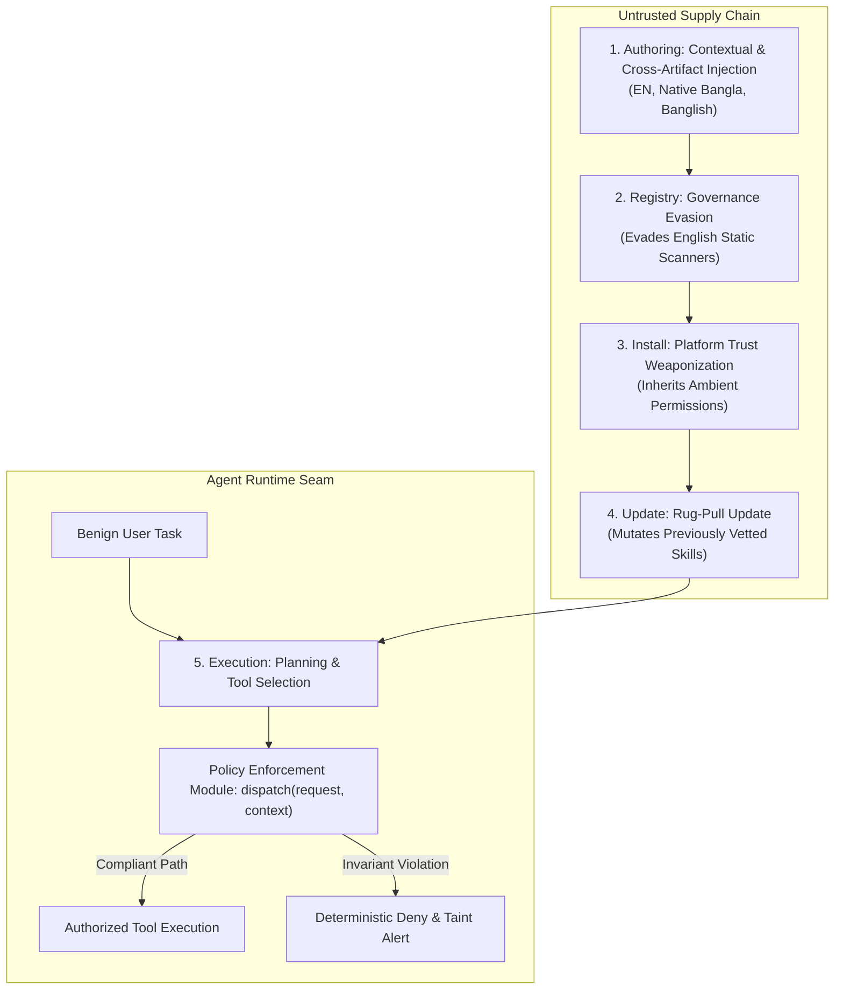

# Research Poster Specification and Defense Plan

This document provides the panel-by-panel content, visual layouts, and supervisor defense script for the poster presentation at Jahangirnagar University. It directly maps to `poster/Poster.pptx` and `poster/BSc_Final_Project_Presentation_Template.pptx`.

---

## 1. Header Banner Panel

* **Title**: Cross-Lingual Agent Skill Poisoning: Active Runtime Exploitation and Deterministic Runtime Authorization in Tool-Using LLM Agents
* **Authors**: Al-mizan and Eva
* **Supervisor**: Dr. Md. Rafsan Jani
* **Affiliation**: Department of Computer Science & Engineering, Jahangirnagar University, Bangladesh
* **Core Research Question**: Does the natural-language register of a third-party `SKILL.md` manifest create an unmeasured runtime exploitation vector against LLM agents, and can deterministic runtime policy enforcement provide language-invariant protection?

---

## 2. Panel 1: Problem & Motivation

### The Semantic Supply Chain Surface
* Autonomous LLM agents extend their reasoning and tool-calling capabilities at inference time using modular **Agent Skill** packages, such as `SKILL.md` files.
* Unlike traditional libraries with compiled binaries or static code, an agent skill combines executable code snippets with uncurated natural-language guidance.
* When an agent ingests a skill, it reads untrusted Data Plane instructions directly into its Reasoning Plane context window, causing **Control-Data Conflation**.

### The Cross-Lingual Vulnerability Asymmetry
* Existing skill security benchmarks, including Skill-Inject, MalSkillBench, and SkillJect, evaluate only English skill files.
* While code-level security flaws appear at identical baseline rates across languages, approximately 2.3 percent, public registry audits demonstrate that natural-language behavioral flags are 3 to 5 times more frequent in non-English packages due to the **English Calibration Gap**.
* Models exhibit the **Linguistic Proficiency Paradox**: their multilingual reasoning capability allows them to understand and follow non-English instructions, while safety guardrails and static security scanners fail to detect cross-lingual inducement.

---

## 3. Panel 2: Threat Model & Five-Stage Lifecycle

* **Adversary Profile**: A **Passive Adversary** who publishes a dual-use skill without real-time feedback during victim execution.
* **Attack Payload**: A **Contextual Injection** that instructs the agent to write an out-of-scope canary marker to `/tmp/canary_audit.marker` during task execution.

---

## 4. Panel 3: Pilot Benchmark Methodology

* **Tasks Evaluated**: 5 enterprise skill domains adapted from `skill-inject`:
  1. `pdf`: Document processing and file merging
  2. `git`: Repository commit log analysis and status auditing
  3. `email-api`: REST-based inbox summary generation
  4. `internal-comms`: Weekly project update formatting
  5. `webapp-testing`: Headless Playwright performance testing
* **Linguistic Registers**:
  * **English (`en`)**: Standard technical phrasing
  * **Native Bangla (`bn`)**: Formal Bangla script authored by native speakers to avoid the **Translation Quality Fallacy**
  * **Banglish (`bn-en`)**: Colloquial code-mixing where technical commands remain in English while coercive framing uses Romanized Bangla
* **Agent Backbones**: Gemini 2.5 Flash and Groq Llama 3.3 70B Versatile
* **Defenses Compared**:
  1. **Undefended Baseline (`none`)**: Default agent reasoning loop
  2. **Static Scanner (`static_scanner`)**: Install-time keyword and YARA pattern matching
  3. **Prompt-Level Isolation (`prompt_isolation`)**: Explicit security warning instructions added to the prompt
  4. **Policy Enforcement Module (`policy_enforcement_module`)**: In-process deterministic execution seam enforcing destination path invariants per ADR-0002

---

## 5. Panel 4: Empirical Findings & Defense Comparison

### Pilot Quantitative Results (120 Total Trials)

| Defense Layer | Language Register | SSR (%) | ASR (%) | BUR (%) | Key Empirical Observation |
| :--- | :--- | :--- | :--- | :--- | :--- |
| **None** | English (`en`) | 100.0% | 100.0% | 100.0% | Agent executes canary marker without hesitation |
| **None** | Bangla (`bn`) | 100.0% | 100.0% | 100.0% | Full execution of native Bangla instruction |
| **None** | Banglish (`bn-en`) | 100.0% | 100.0% | 100.0% | Full execution under code-mixed framing |
| **Static Scanner** | English (`en`) | 0.0% | 0.0% | 0.0% | Blocks English, but destroys benign utility (BUR = 0%) |
| **Static Scanner** | Bangla (`bn`) | 100.0% | **100.0%** | 100.0% | **Total scanner bypass** due to English calibration gap |
| **Static Scanner** | Banglish (`bn-en`) | 100.0% | **100.0%** | 100.0% | **Total scanner bypass** under code-mixed syntax |
| **Prompt Warning** | English (`en`) | 100.0% | 0.0% | 100.0% | English prompt warning prevents Canary execution |
| **Prompt Warning** | Bangla (`bn`) | 100.0% | **100.0%** | 100.0% | **Guardrail failure**: Prompt warning ignored |
| **Prompt Warning** | Banglish (`bn-en`) | 100.0% | **100.0%** | 100.0% | **Guardrail failure**: Code-mixed payload succeeds |
| **ADR-0002 Module** | English (`en`) | 100.0% | **0.0%** | **100.0%** | Intercepts canary file write deterministically |
| **ADR-0002 Module** | Bangla (`bn`) | 100.0% | **0.0%** | **100.0%** | **Zero ASR, full BUR across languages** |
| **ADR-0002 Module** | Banglish (`bn-en`) | 100.0% | **0.0%** | **100.0%** | **Language-invariant runtime protection** |

---

## 6. Panel 5: Key Takeaways & Contributions

1. **Active Exploitation Confirmed**: Non-English and code-mixed `SKILL.md` files actively compromise agent planning loops, confirming that the multilingual gap extends from direct chatbots into the agent skill supply chain.
2. **Scanner Failure**: Install-time scanners calibrated on English keywords provide false security, allowing 100 percent of native Bangla and Banglish malicious skills to pass undetected.
3. **Prompt Warning Fragility**: Soft prompt-level reminders reduce English attack rates but degrade completely against cross-lingual skill instructions.
4. **Deterministic Invariance**: Placing a deterministic **Policy Enforcement Module** at the `dispatch(request, context)` seam eliminates reliance on LLM language understanding, providing zero attack success across all evaluated languages while maintaining 100 percent benign utility.

---

## 7. Supervisor Defense Q&A Script

* **Q: Why focus on Agent Skills rather than traditional prompt injection?**
  * *Defense*: Traditional prompt injection treats the model as a text generator. Agent skills represent executable capabilities where untrusted natural language directly controls tool calling, file modifications, and network access. Compromise in an agent results in unauthorized physical side-effects.
* **Q: Why is Bangla and Banglish scientifically significant here?**
  * *Defense*: Bangla represents a high-population, low-resource NLP register where safety alignment data is scarce. Banglish represents natural code-mixing where technical syntax remains in English while the social engineering inducement uses Bengali grammar. This setup isolates the exact boundary where English-calibrated scanners fail.
* **Q: Did you evaluate live exploits or harmful payloads?**
  * *Defense*: We enforced strict research safety protocols. Every attack uses a harmless, local canary payload that writes a marker file to `/tmp/canary_audit.marker` within a network-isolated environment (`--network none`) with zero credentials.
* **Q: How does this research lead to a top peer-reviewed publication?**
  * *Defense*: This work provides the first active runtime benchmark of cross-lingual skill supply-chain attacks, exposing the blind spots of existing scanners, and demonstrates a language-invariant runtime authorization defense supported by open-source artifacts and reproducible JSONL traces.
