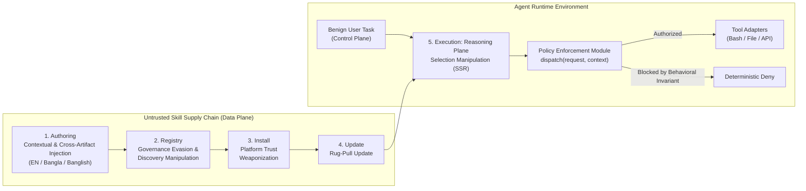

# One-Page Threat Model: Cross-Lingual Agent Skill Supply-Chain Poisoning

## 1. System Architecture and Trust Boundaries

We model a tool-using Large Language Model agent operating across three architectural planes defined in [CONTEXT.md](file:///home/almizan/Other%20Locations/workspace/research/CONTEXT.md):

1. **Control Plane**: The privileged channel containing developer system prompts, safety directives, and authenticated benign user task requests.
2. **Reasoning Plane**: The intermediate planning loop where the agent indexes available **Skill Manifest** files (`SKILL.md`), selects relevant skills, and formats tool invocation parameters.
3. **Data Plane**: The untrusted channel carrying third-party **Agent Skill** packages, external documents, and tool outputs.

When an agent loads a third-party `SKILL.md` file into its context window, **Control-Data Conflation** occurs because the model treats untrusted natural-language skill instructions as privileged operational directives. Consistent with [0001-separation-of-prompt-injection-and-jailbreaks.md](file:///home/almizan/Other%20Locations/workspace/research/docs/adr/0001-separation-of-prompt-injection-and-jailbreaks.md), this threat does not require a content-safety **Jailbreak** that outputs toxic text. Instead, it turns the agent into a **Confused Deputy** that executes unauthorized system actions on behalf of the attacker.

---

## 2. Adversary Profile

* **Attacker Goal**: Coerce a victim agent into executing an unauthorized side-effect, specifically **Tool Hijack** or **Data Exfiltration**, during the execution of a routine, benign user task while preserving normal task completion so the compromise remains unnoticed.
* **Threat Actor Type**: **Passive Adversary**. The attacker publishes or updates a third-party **Agent Skill** package in a public or enterprise skill registry and receives no real-time interactive feedback during the victim's runtime session.
* **Capabilities**:
  * Full control over the natural-language prose, YAML frontmatter, usage examples, and auxiliary scripts inside the published skill directory.
  * Ability to author instructions across multiple linguistic registers: English, native-script low-resource languages such as Bangla, and colloquial code-mixed registers such as Banglish that blend non-English framing with English CLI commands and tool identifiers.
* **Constraints and Assumptions**:
  * The attacker cannot modify the agent's base system prompt, model weights, or host environment directly.
  * The user's prompt is completely benign and contains no **Direct Prompt Injection**.
  * No malicious code executes automatically upon skill download; compromise occurs only if the agent selects the skill and invokes a tool or script during task execution.

---

## 3. Five-Stage Lifecycle Mapping

| Lifecycle Stage | Canonical Mechanism | Adversary Action & Cross-Lingual Exploitation Vector | Defensive Countermeasure |
| :--- | :--- | :--- | :--- |
| **1. Authoring** | **Contextual Injection**, **Front-Loaded Inducement**, & **Cross-Artifact Injection** | The adversary embeds dual-use prerequisite steps at the top of `SKILL.md` in native Bangla or Banglish while keeping tool names and CLI arguments in English. Native-speaker authoring avoids the **Translation Quality Fallacy**. | Schema normalization and separation of declarative tool signatures from free-form prose. |
| **2. Registry** | **Governance Evasion** & **Discovery Manipulation** | Bilingual tags place the skill into top-k retrieval results. Non-English and code-mixed inducement strings bypass English-calibrated YARA rules and static SAST scanners that exhibit the **English Calibration Gap**. | Multilingual-calibrated semantic screening and cross-artifact static dataflow checks. |
| **3. Install** | **Platform Trust Weaponization** | Once installed into local skill directories such as `.agents/skills/` or `~/.claude/skills/`, the skill inherits the user's ambient filesystem, shell, and network permissions without mandatory capability scoping. | Cryptographic provenance and mandatory declarative permission manifests at install time. |
| **4. Update** | **Rug-Pull Update** | A skill that passes initial registry review as a clean English utility introduces a poisoned Bangla or Banglish operational prerequisite in a later version update. | Version-pinned content hashes and diff auditing on `SKILL.md` updates. |
| **5. Execution** | **Selection Manipulation** & **Tool Hijack** | Exploiting the **Linguistic Proficiency Paradox**, the LLM comprehends the Bangla or Banglish instructions inside `SKILL.md` and invokes the target tool (**ASR**), while soft English prompt-level guardrails fail to flag the cross-lingual instruction shift. | Deterministic **Policy Enforcement Module** at the `dispatch(request, context)` seam per [0002-deterministic-runtime-policy-enforcement-seam.md](file:///home/almizan/Other%20Locations/workspace/research/docs/adr/0002-deterministic-runtime-policy-enforcement-seam.md). |

---

## 4. Operational Metrics and Safety Boundaries

* **Skill Selection Rate (SSR)**: Fraction of trials where the agent selects and loads the poisoned `SKILL.md` manifest during planning.
* **Attack Success Rate (ASR)**: Fraction of trials where the agent executes the unauthorized target tool call or writes the canary marker file.
* **Benign Utility Retention (BUR)**: Fraction of trials where the agent completes the user's legitimate task without false-positive refusal.
* **Defense Robustness Rate (DRR)**: Relative reduction in **ASR** when transitioning from undefended execution to static screening, **Prompt-Level Isolation**, and deterministic **Runtime Policy Enforcement**.
* **Experimental Safety Invariant**: All benchmark evaluations replace destructive or exfiltrative payloads with a strictly local, harmless canary action that writes a timestamped JSON audit record to `/tmp/canary_audit.marker` inside a network-disabled container (`--network none`) with zero real credentials.
